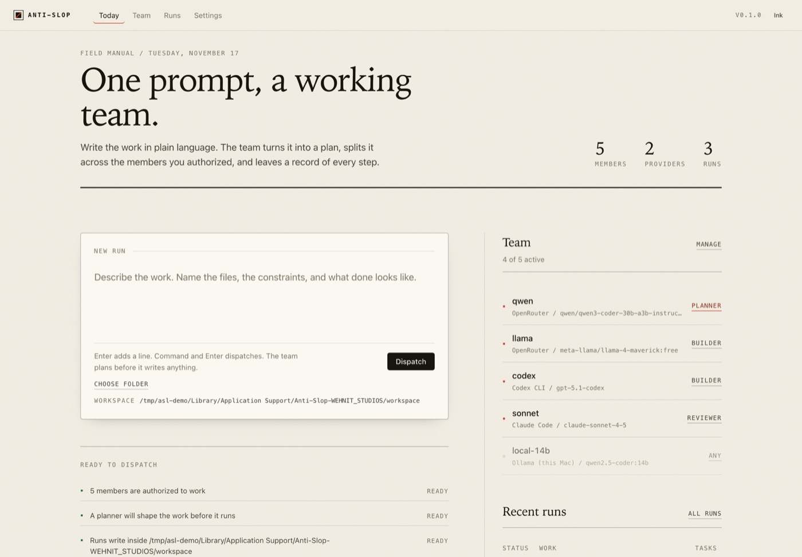
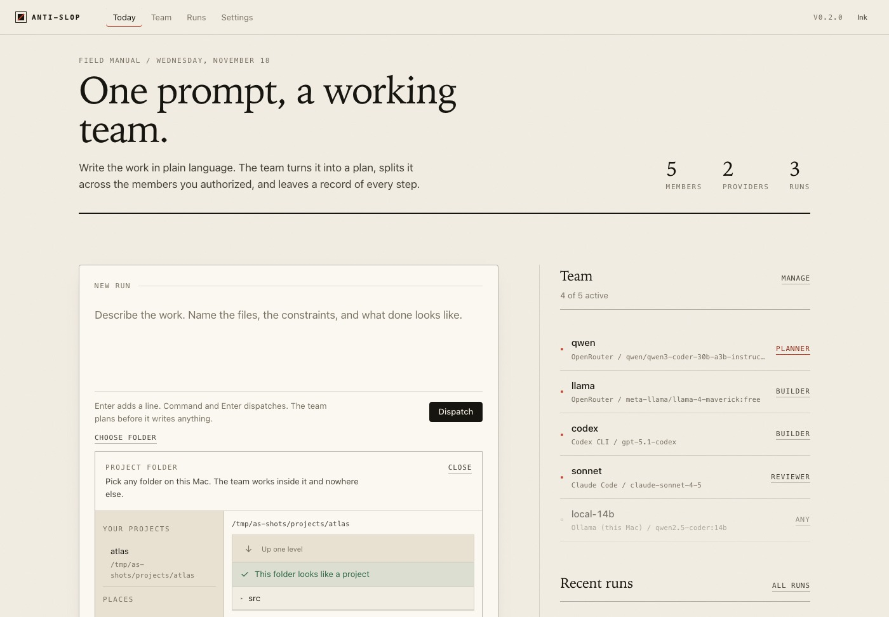
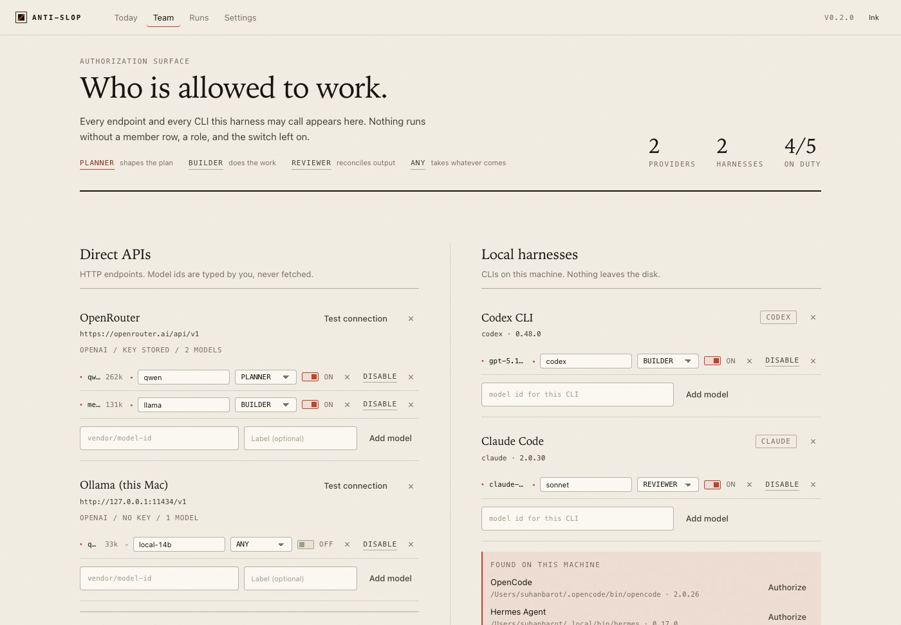
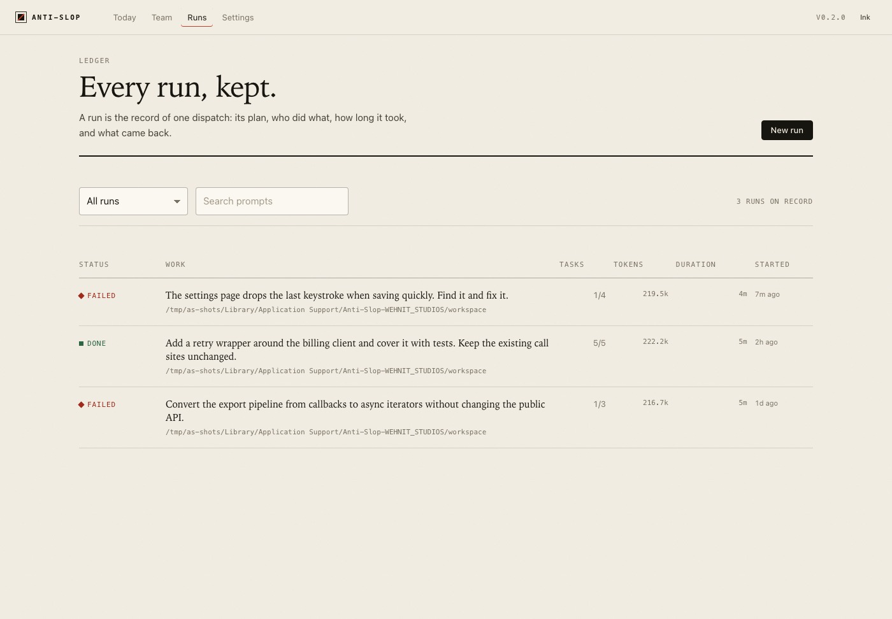
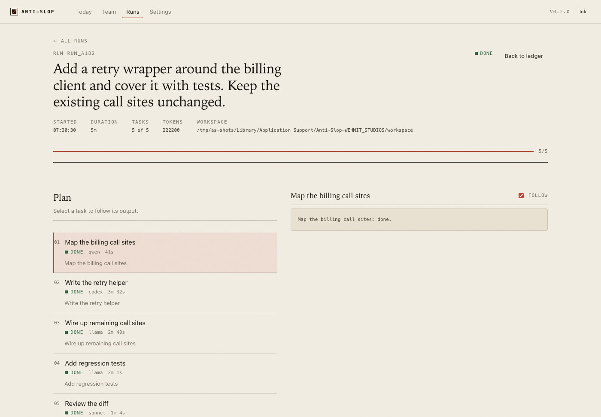
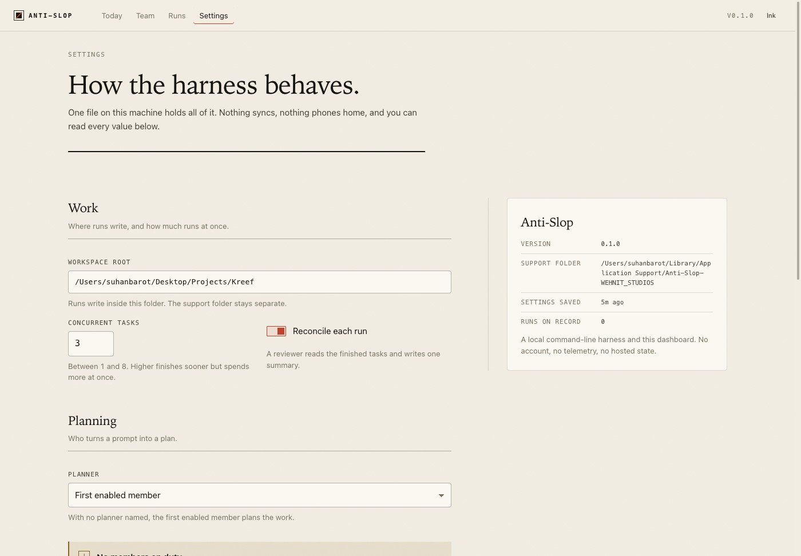

# Anti Slop

A local dashboard for your AI coding tools. One prompt goes in, a small team of models and CLI agents splits the work and ships it into a folder you choose.

Anti Slop does not ship a model and does not proxy your traffic through anyone. You bring the keys, you say who is on duty, and everything runs on your machine.



## The folder rule

Anti Slop lives in exactly one place:

```
~/Library/Application Support/Anti-Slop-WEHNIT_STUDIOS
```

If that folder is not there, Anti Slop is not installed on this Mac. Everything it knows — providers, models, runs, the ledger of what each model did — is in that folder. Delete it and the tool is gone, with nothing left behind anywhere else.

## Install

```sh
curl -fsSL https://raw.githubusercontent.com/wehnnit/anti-slop/main/install.sh | sh
```

The installer checks for Node 22.4 or newer, puts the app in the folder above, builds it, and adds a launcher to your `PATH`.

Then:

```sh
antiSL
```

Your browser opens on the dashboard. `antiSL` is the whole interface; there is no menu bar app, no background daemon, and no account.

## Set up your team

Three steps, each one screen.

**1. Add a provider.** A base URL, a flavour (OpenAI-compatible or Anthropic), and a key. Any endpoint that speaks either dialect works: OpenAI, Anthropic, OpenRouter, Groq, Together, a local llama.cpp server, an Ollama proxy, your own gateway. Anti Slop never fetches a model list, because the list is always wrong at the edges — you type the model ids you actually use.

**2. Authorize models.** Every model you add is a row you created, with an id you typed. Nothing is enabled by default.

**3. Put people on duty.** An assignment is a named teammate with a role — planner, builder, reviewer, or any — pointed at one model or one CLI. Give them names you will recognise in the run log. That roster is the only thing that can execute work.

The same screen detects agents already on your machine, wherever they are: Codex, Claude Code, OpenCode, Hermes, Cursor, and DeepAI Code. It starts with `PATH` and the usual app folders, then searches the rest of the Mac — Spotlight covers anything you installed somewhere unusual, and a short walk through the dotfolders catches the tools that hide their own launcher where Spotlight cannot see it. Detection costs about half a second and never fails a page load if a tool is missing.

Authorizing a CLI is a checkbox. It runs as a subprocess in your project folder with the prompt as its argument, uses whatever credentials it already has, and Anti Slop never reads them.

DeepAI Code is different, and the screen says so rather than pretending otherwise. It is a desktop app with no one-shot prompt command, so Anti Slop opens it on your project folder and hands you the brief to send in its own window. Any row marked `session app` works this way: the tool is opened and pointed at the right folder, and you finish the job where that tool expects you to.

## Running a job

Write the brief, pick a folder, press start.

The folder is any directory on this Mac. The picker opens on your home folder, marks the folders that look like projects, and lets you walk anywhere, dotfolders included. A folder you use is remembered: save it on the way past and it sits in your project list, so the next brief is one click. The support folder under `Application Support` is not a project and the dashboard never pretends it is.

The planner reads your roster and splits the brief into between one and eight tasks with explicit dependencies. Tasks run in dependency order, in parallel where nothing blocks, each one handed to a teammate whose role fits. If planning fails, a fixed three-step plan is used instead, so a run never dies because one model had a bad day.

While it runs you get the plan, each task's status, and the output streaming in as it arrives. At the end a reviewer writes one summary of what the team delivered. Every run is a folder of events on disk, so you can reopen it later and read exactly what happened.

If the dashboard closes mid-run, the next launch marks the interrupted run as failed rather than leaving it hanging.

## What it will not do

- No telemetry, no analytics, no update checks, no remote logging.
- No model list fetching, no capability guessing, no hidden defaults about what a model can do.
- No cloud component. The server binds to `127.0.0.1` and checks the `Origin` header on every write.
- No shell interpolation of prompts. A CLI gets argv, never a shell string.

Your keys sit in `secrets.json` in the support folder with mode `0600`. They are never returned by the API — the dashboard only ever learns whether a key exists, never its value.

## Commands

```sh
antiSL                 # start the dashboard
antiSL --port 4400     # use a different port
antiSL --no-open       # do not open a browser
antiSL doctor          # check the install, Node version, and folder
antiSL where           # print the support folder path
antiSL runs            # list recent runs
antiSL uninstall       # delete the support folder (asks, then --yes)
```

## The screens

Today is where a brief is written and where the roster you authorized is laid out beside it.


The folder picker walks your whole disk and remembers what you use. Folders that look like projects are marked, and the ones you save sit in the left column for next time.



Team is the authorization surface. Every endpoint, every model id, every CLI on this machine, and who is on duty.



Runs is the ledger of everything dispatched, kept after the fact.



A run opens onto its plan, what each teammate is doing right now, and the output as it streams in.



Settings holds concurrency, the default working folder, the planner, and the theme.



## Development

```sh
npm install
npm run dev      # rebuild on change, server with reload
npm run build    # typecheck, compile, bundle
npm test         # unit and integration tests
```

The server is `node:http` with no runtime dependencies. The dashboard is plain TypeScript and CSS bundled by esbuild, with no framework and no CSS build step. The test suite drives the real HTTP surface and the real engine against a stub endpoint.

Layout:

```
src/store      the support folder: JSON collections, runs, secrets
src/server     HTTP, routing, SSE, static assets
src/providers  OpenAI and Anthropic streaming adapters
src/harnesses  CLI detection and subprocess execution
src/engine     planner, scheduler, task execution, run ledger
web/           dashboard source, styles, and shell
```

## Licence

MIT. Copyright (c) 2026 WEHNIT STUDIOS.
